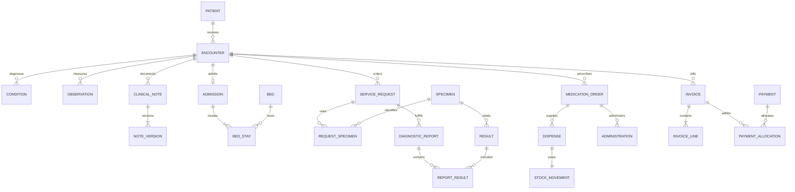

# Модель данных и проектные решения

## Идентичность и организация

`mpi.patient.id` — внутренний суррогатный ключ. `public_id` — UUID для внешних ссылок, `mrn` — уникальный медицинский номер. Ни один из них не является разрешением доступа. Дополнительные идентификаторы уникальны в рамках URI системы; в учебных данных намеренно нет ИИН, паспортов, реальных телефонов и адресов электронной почты.

Пациент не принадлежит одному отделению: его клиническая история пересекает площадки и специальности. Организационная иерархия хранится отдельно: сеть → площадка → отделение → помещение → койка. Принадлежность врача отделению имеет период действия, а не зашита в одну изменяемую колонку сотрудника. Документы о квалификации и парк оборудования моделируются самостоятельными сущностями.

Слияние MPI сохраняет источник и целевой ID с автором и причиной. Автоматическое массовое переподчинение клинических фактов намеренно не реализовано: это отдельный контролируемый процесс, поскольку ошибочное объединение историй существенно опаснее дубликата. Учебный источник слияния не содержит клинических записей и помечен неактивным.

## Эпизод лечения как центр клинической истории

Клинические дочерние записи содержат и `patient_id`, и `encounter_id`. Это осознанная контролируемая избыточность для RLS и маршрута чтения; составной внешний ключ `(encounter_id, patient_id)` гарантирует, что они не разойдутся. Статусы проверяются `CHECK`, допустимые переходы эпизода — триггером. Начало эпизода не может предшествовать рождению или следовать за зарегистрированной смертью.

Диагноз, аллергия, наблюдение и выполненная процедура разделены. Подозрение не подменяет подтверждённый диагноз. Наблюдение содержит ровно один тип значения; единица для числа должна соответствовать каталогу теста. Статус диагноза и статус верификации хранятся раздельно. Клиническая терминология вынесена в версионируемые системы кодов; `DEMO-*` — явно учебные концепты.

Медицинская запись имеет неизменяемую подписанную версию и указатель на текущую версию. Указатель защищён отложенным внешним ключом: записать новую версию и переключить указатель можно в одной транзакции. Исправление содержит ссылку на предшествующую версию и причину. `SHA-256` вычисляется самой БД, но не подменяет криптографическую подпись медицинского работника.

Полные клинические тексты не копируются в аудит. Это уменьшает неуправляемое дублирование чувствительных данных. Для расследований сохраняются actor, transaction ID, сущность и изменённые поля; подписанные тексты доступны в таблице версий.

## Госпитализация и временные ограничения

`adt.admission` — административный эпизод стационара внутри inpatient encounter. Период госпитализации охватывает последовательные `bed_stay`. Ограничения GiST запрещают пересечения для одной койки и одного пациента. Отдельное исключающее ограничение запрещает одновременно две госпитализации пациента. Открытый конец означает продолжающееся пребывание; бесконечный нижний конец и пустой период запрещены.

Триггер проверяет, что период койки находится внутри госпитализации и койка активна. Обновление границ госпитализации не может вытолкнуть существующие размещения за её пределы. Выписка связывает завершённое пребывание с медицинским итогом того же пациента и должна иметь тот же момент окончания, что и госпитализация.

Расписание специалиста, отдельный интервал и запись пациента разделены. Ограничения пересечений действуют независимо для врача, кабинета и пациента. Для ограничения пациента в записи хранится контролируемая копия периода слота: триггер заполняет её автоматически, а изменение периода уже связанного слота запрещено. Запись ссылается на конкретный слот; на один слот приходится не более одной записи. Статусы `cancelled`/`noshow` сохраняют историю. Для повторного использования слота после отмены реальному приложению понадобится процесс перепланирования/история отмен: текущая референсная схема не удаляет старую запись автоматически.

## Диагностика

Лабораторный контур сохраняет прослеживаемость: назначение врача → взятый материал с accession number → аналитический результат → версия заключения. Материал может обслуживать несколько назначений, а заключение включает несколько результатов. Составные ключи исключают перенос между пациентами; дополнительный триггер запрещает привязать к заключению материал из другого назначения даже того же пациента. Измерение не предшествует поступлению материала.

Значение, единица, референсные границы и интерпретация не смешиваются в одном текстовом поле. В демонстрационных тестах A/B/C используется `AU`, нет выдаваемых за клиническую норму референсных интервалов. Медицинскую интерпретацию должен задавать проверенный справочник и утверждённый лабораторный процесс.

Визуальная диагностика хранит UID исследования и серии, modality, оборудование и ссылку на PACS/object storage. В стенде URI имеют префикс `urn:demo:` и не ведут к изображениям. PostgreSQL не превращается в хранилище больших DICOM BLOB. Modality исследования проверяется по прибору.

## Лекарства и склад

Назначение, отпуск и факт введения — разные документы. Отпуск обязан соответствовать назначенному препарату, партии, сроку годности и периоду действия назначения. Назначения учебные и не содержат дозировочных рекомендаций. Факт введения может ссылаться на отпуск только того же назначения и пациента и не предшествует ему.

Складской журнал `stock_movement` неизменяем. Компенсация оформляется отдельным движением. `stock_balance` — транзакционно поддерживаемая проекция журнала. Обновление баланса захватывает блокировку соответствующей пары `(location,lot)` и проверяет неотрицательность. Параллельные операции одной партии сериализуются; разные партии не блокируют друг друга глобально. AFTER-триггер отпуска автоматически создаёт складское движение в той же транзакции; ошибка остатка отменяет и отпуск.

Закупки моделируют заказ и строки заказа; партия имеет поставщика, дату поступления и срок годности. FEFO-выбор партии, резервирование, сверка реальных накладных и межскладской workflow должны быть реализованы сервисным слоем. В этой версии есть типы transfer-in/out, но создание согласованной пары переводов не является публичной хранимой процедурой.

## Расчёты

Тариф — действующая во времени цена услуги для плательщика. Строка счёта сохраняет фактически выставленную цену как снимок; последующее изменение тарифа не меняет выставленные документы. Денежные значения используют `numeric`, а не `float`. Отрицательные количества, чрезмерные скидки и некорректная ставка налога отклоняются. Производные суммы строки вычисляются БД.

Сумма счёта рассчитывается по строкам, оплаченная сумма — по распределениям. Платёж не равен счёту: один платёж может закрывать несколько счетов, а один счёт — оплачиваться несколькими платежами. Триггер распределения блокирует платёж и счёт, проверяет пациента, плательщика, валюту, доступный остаток платежа и долг счёта. Оплата и её распределение неизменяемы; production workflow возвратов, кредит-нот и бухгалтерского закрытия здесь не реализован и не имитируется отрицательными суммами.

## Безопасность и аудит

RLS работает на таблицах пациента и клинических/финансовых фактов, включая зависимые таблицы версий записей и серий изображений. `FORCE ROW LEVEL SECURITY` включён; для служебного владельца существует явная политика. Подчинённые партиции закрыты для прикладных ролей: прямой `SELECT` по партиции не должен обходить политику родителя.

Функции `SECURITY DEFINER` имеют фиксированный `search_path`, обращаются к объектам с явной схемой и не исполняют пользовательский SQL. Разрешения `EXECUTE` для PUBLIC сняты. Ни одна прикладная роль не является superuser, BYPASSRLS, владельцем БД или владельцем таблиц. Предоставление доступа и break-glass не доступны обычным ролям; экстренный доступ имеет одобрившего пользователя, причину и длительность не более часа.

Для DML автор аудита берётся из `session_user`. Автор клинических записей также сверяется с учётной записью сотрудника. Запрещено переносить существующий факт другому пациенту простым `UPDATE patient_id`. Изменения MPI и финансового контура требуют проверяемых workflow. Администратор и владелец схемы остаются доверенными: локальный журнал не защищён от злонамеренного superuser. Для независимого контроля нужны внешнее журналирование и защищённое хранение.

## Производительность и обслуживание

Ключи идентичности — bigint для локальных joins, UUID — только для внешних стабильных ссылок. Все внешние ключи обеспечены индексом с подходящим ведущим набором колонок. Наблюдения имеют помесячные партиции, BRIN по времени и индекс для ленты пациента. Активные эпизоды и ожидающий outbox имеют частичные индексы; MPI — trigram-поиск, адреса и площадки — пространственные GiST.

Агрегаты посещений и выручки материализованы и допускают concurrent refresh по уникальному индексу. Счётчики `reltuples` приблизительны; отчёт установки использует точный `count(*)`. Нагрузочные результаты в `VERIFICATION.md` относятся к этому компьютеру и синтетическому набору. Они не являются SLA или результатом многопользовательского испытания всего приложения.

## Концептуальное сопоставление FHIR R4

| Таблицы | Ресурс |
|---|---|
| `mpi.patient`, identifier/address/contact | Patient |
| `org.organization`, site/department/room/bed | Organization / Location |
| staff, staff_department, credential | Practitioner / PractitionerRole |
| ehr.encounter, encounter_participant | Encounter |
| ehr.condition, allergy, observation, procedure | Condition / AllergyIntolerance / Observation / Procedure |
| care_plan, document, immunization | CarePlan / DocumentReference / Immunization |
| scheduling.schedule/slot/appointment | Schedule / Slot / Appointment |
| lab.service_request/specimen/diagnostic_report/result | ServiceRequest / Specimen / DiagnosticReport / Observation |
| imaging.study/series | ImagingStudy |
| pharmacy.medication_order/dispense/administration | MedicationRequest / MedicationDispense / MedicationAdministration |
| billing.coverage/claim | Coverage / Claim |
| audit.event/access_event, note_version | AuditEvent / Provenance (частично) |

Таблицы нормализованы для транзакционной БД. Для настоящего FHIR API необходимы сериализация, профили, cardinality checks, терминологический сервис, CapabilityStatement, search semantics и conformance tests; наличие таблиц с похожими именами этого не обеспечивает.
